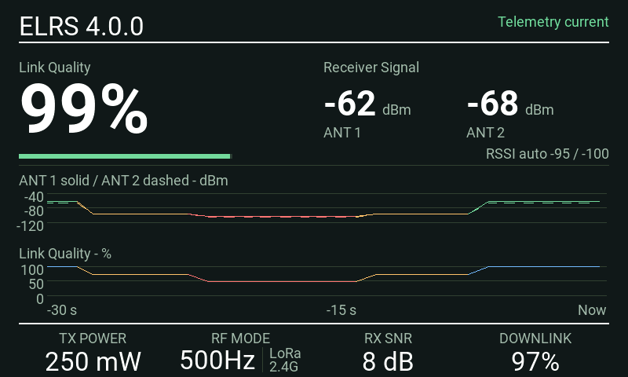
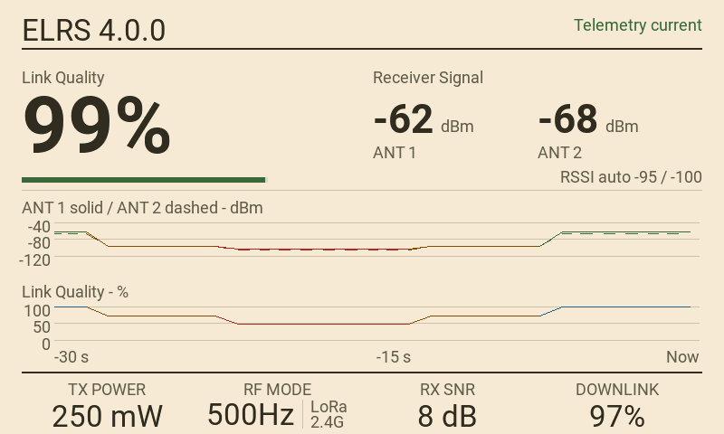
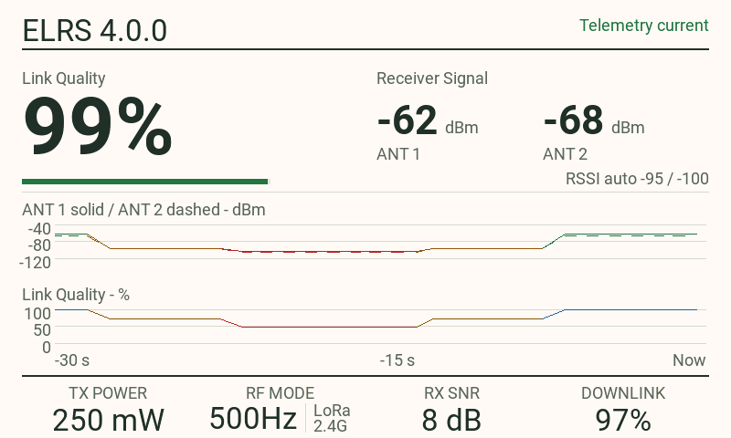
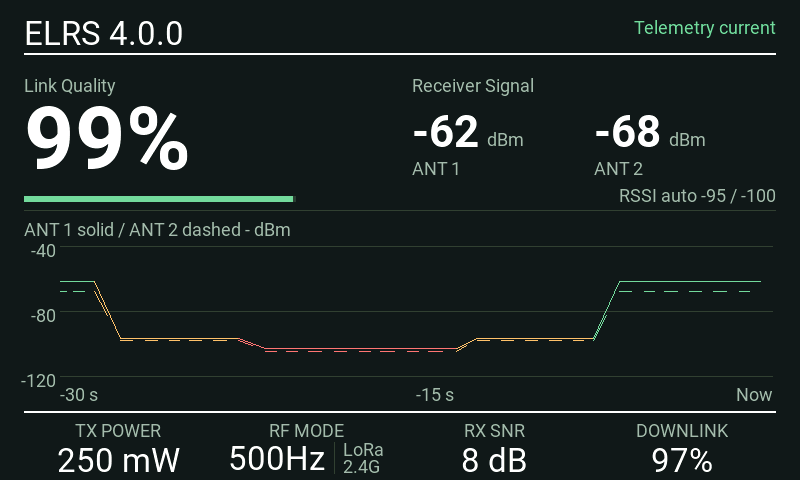
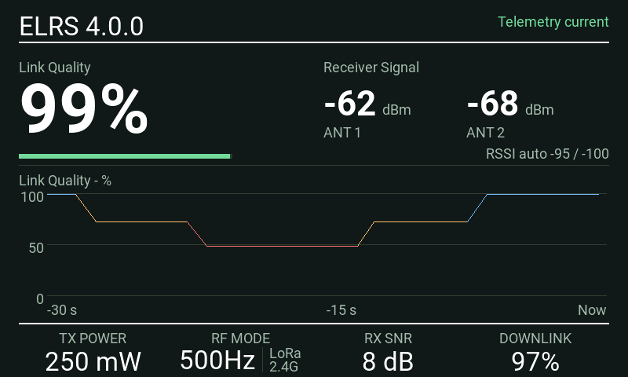

# ELRS SignalView

A receiver-signal and Link Quality dashboard for EdgeTX color-screen radios using ExpressLRS telemetry.

**Version 0.4.0.**

[Download SignalView](https://github.com/Pencilvestr/elrs-signalview/releases/download/v0.4.0/elrs-signalview-0.4.0.zip) · [Release notes](https://github.com/Pencilvestr/elrs-signalview/releases/tag/v0.4.0)

*Native EdgeTX 2.12.5 simulator capture. The loop starts disconnected, then shows synthetic signal changes, warning colors, scrolling history and changing footer values.*

## Features

- **Three themes:** Dark, Rich Ivory and White. Dark is the default.
- **Selectable history:** show both graphs, Receiver Signal only or Link Quality only. Single graphs use the full history area; switching views retains the recorded data.
- **History retained on telemetry loss:** when all main graph sources become unavailable, the graphs freeze with an elapsed-loss timer. Current readings show `--`; reconnection leaves a break in the history.
- **Automatic antenna display:** show one or two usable RSSI paths, with Auto, Single and Dual overrides. Dual view uses solid and dashed traces.
- **Configurable warning colors:** healthy, amber and red readings and traces, with automatic or manual RSSI thresholds and a recovery delay.
- **Four selectable footer readings:** choose supported ELRS telemetry using EdgeTX's source picker. Defaults are TX power, RF mode, receiver SNR and downlink quality.
- **Readable RF modes:** ELRS 3.x/4.x rate names, with modulation and band on larger screens when known. The header shows the transmitter module's reported firmware version when available.

Use full screen or a single near-full-screen widget area with the **EdgeTX top bar off**. Layouts adapt to the tested landscape and portrait screens. Small or multi-widget areas stay blank.

## Install and update

Download the [0.4.0 installation ZIP](https://github.com/Pencilvestr/elrs-signalview/releases/download/v0.4.0/elrs-signalview-0.4.0.zip). Use this package rather than GitHub's source-code archive.

1. Back up your model settings and SD card.
2. Copy the package's `WIDGETS/SignalView` folder into the SD card's existing `WIDGETS` directory.
3. Confirm the file is at `/WIDGETS/SignalView/main.lua`, then restart the radio.
4. Add **SignalView** to a single-widget screen with the top bar off, or open it full screen.
5. Establish the ELRS connection and discover telemetry sensors in EdgeTX if needed.

When updating:

- **Upgrading from 0.3.0 or a build without Theme first:** record your settings and remove the old widget instance. After replacing the Lua and restarting, add SignalView again and restore the settings. EdgeTX stores widget options by position.
- **Updating a recent build with Theme already first:** replace the Lua and restart. Adding History preserves the existing option positions.
- **RSSI mode changed from text to a dropdown:** this field initializes to Auto on upgrade. Reselect Manual or Off if required.

See [installation, bench checks and rollback](docs/INSTALLATION.md).

## Settings

Open **Widget Settings**. Choices are stored per widget instance in the model.

| Setting | Default | Purpose |
| --- | --- | --- |
| Theme | Dark | Dark / Rich Ivory / White |
| LQ amber | 80% | Amber below this value |
| LQ red | 60% | Red below this value |
| RSSI mode | Auto | Auto / Manual / Off dropdown |
| RX amber | −98 dBm | Manual RSSI warning threshold |
| RX red | −103 dBm | Manual RSSI critical threshold |
| Recover s | 1 | Delay before improved readings return to a better color |
| Footer 1–4 | TPWR / RFMD / RSNR / TQly | Select supported ELRS sources using the native picker |
| Antennas | Auto | Auto / Single / Dual |
| History | Both | Both / Receiver Signal / Link Quality |

Automatic RSSI thresholds use the current **ELRS 4.x** RF mode's sensitivity limit plus 10 dB for amber and plus 5 dB for red. For ELRS 3.x, use Manual or Off. Unknown modes or unsupported versions show that Auto is unavailable rather than guessing a threshold. RF-mode names and automatic RSSI thresholds have different version support.

Auto antenna display infers usable telemetry paths, not the physical antenna count. Both paths must qualify together for one second before first showing dual view. Established dual view survives partial dropouts. After complete link-data loss, five continuous seconds with only one usable path switches back to single view; both paths qualifying for one second restores or retains dual view.

The warning stages and recovery timing are display policies, not a prediction of failsafe or remaining range. See [settings and thresholds](docs/SETTINGS.md), [RF-mode support](docs/RF-MODES.md) and [telemetry behavior](docs/TELEMETRY.md).

## Screenshots

All images below are native simulator captures with synthetic telemetry. They are not photographs or live RF measurements. Capture versions and source hashes are recorded in the [image manifest](docs/images/manifest.json).

### Themes

| Dark | Rich Ivory | White |
| --- | --- | --- |
|  |  |  |

Healthy readings are white in Dark and dark text in the light themes. Normal receiver history and the LQ bar are green; normal LQ history is blue. Amber and red indicate degraded values in all three themes.

### History views

| Both — default | Receiver Signal | Link Quality |
| --- | --- | --- |
|  |  |  |

The main readings and footer stay in place. Receiver-only history retains both antenna traces when dual view is active. Both histories continue to be collected in the same bounded buffer.

### Telemetry loss

The last history remains visible with a **History frozen** timer. The `Now` label stays at the right edge of that frozen history. Selecting one graph does not change loss detection: freezing begins when all three main graph sources are unavailable.

See the [full screenshot gallery](docs/SCREENSHOTS.md) for warning states, smaller landscape layouts and the NV14 portrait layout.

## Known working hardware

This is a running list of physical-radio reports. A report applies to the tested build and setup, not every later revision.

| Radio | Module / ELRS | EdgeTX | Reported testing |
| --- | --- | --- | --- |
| RadioMaster TX16S MK3 | Internal ELRS 4.0.0 | 2.12.5 | Maintainer confirmed the 0.3.0 release candidate and subsequently tested 0.4.0 development builds. Physical confirmation of the final RSSI dropdown change is pending. |
| PA01 | ELRS 4.1.0; module unspecified | Unknown | Community tester reported published 0.3.0 working correctly; report confirmed by the maintainer. |

Receiver models, receiver firmware, test duration and in-flight validation have not been recorded. Please include these details in new hardware reports.

## Known Issues

## Support

## Help and feedback

Use the repository's [issue forms](https://github.com/Pencilvestr/elrs-signalview/issues/new/choose) for bugs, feature requests and hardware reports. Include the widget version, radio model, exact EdgeTX/ELRS versions, receiver model, relevant settings and a screenshot or complete error message. Do not include binding phrases, credentials or a personal SD-card dump.

- [Troubleshooting](docs/TROUBLESHOOTING.md)
- [Telemetry and display reference](docs/TELEMETRY.md)
- [Architecture and function map](docs/DEVELOPMENT.md)
- [Contributing](CONTRIBUTING.md)
- [Changelog](CHANGELOG.md)

## License and attribution

Released under the [MIT License](LICENSE). SignalView is an independent community project, not an official ExpressLRS, EdgeTX or RadioMaster product. See [NOTICE](NOTICE.md) for references and attribution.

