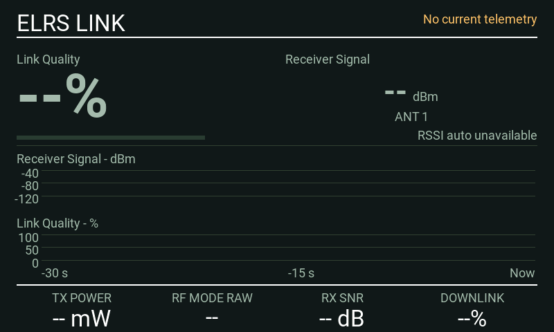
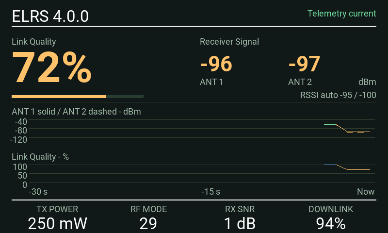
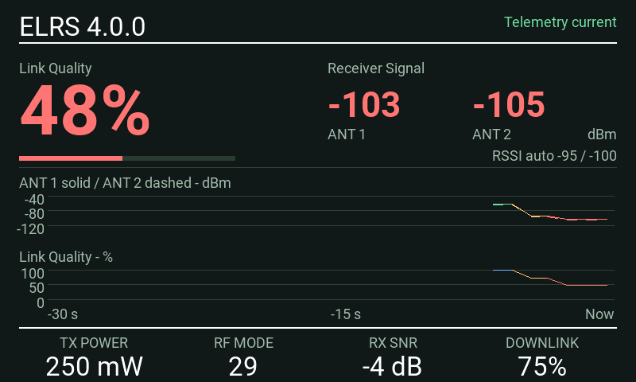

# ELRS SignalView

A full-screen RC-link dashboard for EdgeTX color-screen radios using ExpressLRS telemetry.

**Stable release: 0.2.0.**

*Looping native EdgeTX 2.12.5 simulator capture with synthetic telemetry and a simulated module version response. Signal levels fall and recover while the history scrolls; the loop restarts after 24 seconds.*

## What it shows

- Large Link Quality and receiver-signal readings, with independent antenna values when available.
- A 30-second history of receiver signal and Link Quality. Antenna 1 is solid; antenna 2 is dashed.
- White, amber and red current readings; green normal RSSI history and blue normal LQ history.
- Immediate worsening indications and configurable delayed recovery.
- Automatic RSSI thresholds from the verified ELRS 4.x RF-mode table, or manual thresholds.
- Four selectable ELRS footer readings using EdgeTX's source picker. Defaults: TX power, RF mode, receiver SNR and downlink quality.
- The transmitter module's reported firmware version when discovery succeeds.

It works in full screen and a single near-full-screen widget area. **Use a one-widget layout with the EdgeTX top bar off.** Small widget areas intentionally stay blank. There are no miniature dashboards, prompts, voice alarms, flight logging or RF-setting controls.

## Install

[Download the installation ZIP](https://github.com/Pencilvestr/elrs-signalview/releases/download/v0.2.0/elrs-signalview-0.2.0.zip) from the [release](https://github.com/Pencilvestr/elrs-signalview/releases/tag/v0.2.0).

1. Back up your model and SD card.
2. Copy `WIDGETS/SignalView` from this project into the SD card's existing `WIDGETS` directory.
3. Confirm the file is at `/WIDGETS/SignalView/main.lua`.
4. Restart the radio. Select **SignalView** in the model's widget setup and use a single-widget layout with the top bar off, or open the widget full screen.
5. Establish the ELRS connection and discover telemetry sensors in EdgeTX if necessary.

For the early `ELRS Diag` development builds, remove the old widget instance before adding SignalView. Settings do not automatically migrate between the two widget names. Do not run both instances while testing module-version discovery.

See [installation and updating](docs/INSTALLATION.md) for the full procedure and rollback steps. Release ZIPs are built with [the packaging tool](tools/build_release.py); use an install ZIP rather than a repository source archive when available.

## Known issue

Slight lag was reported on the MK3 with the selectable footer. Version 0.2.0 reduces measured simulator Lua work and retained memory; confirmation on the physical MK3 is pending. See [performance results and limits](docs/PERFORMANCE.md).

## Default settings

| Setting | Default | Meaning |
| --- | --- | --- |
| LQ amber | 80 | Amber below 80% |
| LQ red | 60 | Red below 60% |
| RSSI mode | Auto | Enter `Auto`, `Manual` or `Off` |
| RX amber | -98 | Manual RSSI amber boundary, dBm |
| RX red | -103 | Manual RSSI red boundary, dBm |
| Recover s | 1 | Recovery hold in seconds; 0 disables smoothing |

Auto uses the current ELRS 4.x RFMD sensitivity limit plus 10 dB for amber and plus 5 dB for red. These two stages are a project policy based on ELRS's documented warning-margin guidance. The 80% LQ early warning is also a project choice; ELRS documents 60% as an OSD alarm starting point. None of these values predicts a failsafe or remaining range. [Settings and thresholds](docs/SETTINGS.md) explains boundaries, recovery and limitations.

## Screenshots

| Warning | Degraded |
| --- | --- |
|  |  |

These states use synthetic test values. Screenshots for all five resolutions, settings and full history are in the [screenshot gallery](docs/SCREENSHOTS.md).

## Known working hardware

This is a running list of setups reported working on physical radios. Reports describe the configuration and testing performed; additional hardware reports are welcome through the hardware-test issue form.

| Radio | Module / ELRS | EdgeTX | Reported testing |
| --- | --- | --- | --- |
| RadioMaster TX16S MK3 | Internal ELRS, 4.0.0 | 2.12.5 | Maintainer bench test with an active receiver connection. Source-picker footer tested and reported working; slight lag noted. History scrolling and module-version display also confirmed. |

This hardware report covers earlier beta builds; the 0.2.0 optimization has simulator coverage and awaits hardware confirmation. The receiver model, receiver firmware and test duration for this report still need to be recorded. No in-flight validation has been recorded. New reports should include these details so the list remains useful as firmware and hardware change.

### Simulator coverage

These targets passed native EdgeTX **2.12.5** tests. They are listed separately until physical-radio reports are available.

| Radio / target | Resolution | Evidence |
| --- | --- | --- |
| TX16S MK3 | 800 × 480 | Native simulator; physical report above |
| TX16S | 480 × 272 | Native simulator only |
| TX15 | 480 × 320 | Native simulator only |
| NV14 | 320 × 480 | Native simulator only |
| PA01 | 320 × 240 | Native simulator only |

Automatic RFMD decoding is for **ELRS 4.x**. A detected 3.x module disables Auto RSSI classification; use Manual. An unknown firmware version does not establish 4.x compatibility. See [testing evidence and limits](docs/TESTING.md).

## Help and feedback

Open a bug report using the repository's issue form. Include radio model, exact EdgeTX and ELRS versions, receiver model, widget settings, a photograph or screenshot, and the complete error message. Never include binding phrases, credentials or a complete personal SD-card dump.

- [Troubleshooting](docs/TROUBLESHOOTING.md)
- [Telemetry and display reference](docs/TELEMETRY.md)
- [Architecture and function map](docs/DEVELOPMENT.md)
- [Contributing](CONTRIBUTING.md)
- [Changelog](CHANGELOG.md)

## License and attribution

Released under the [MIT License](LICENSE). This is an independent community project, not an official ExpressLRS, EdgeTX or RadioMaster product. Protocol and documentation references, screenshot provenance and test-runtime attribution are listed in [NOTICE](NOTICE.md).

## Support

[Support the project on Ko-fi](https://ko-fi.com/pencilvestr).
