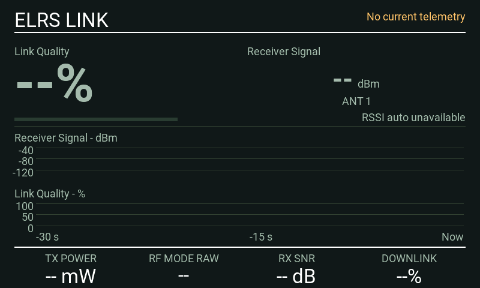
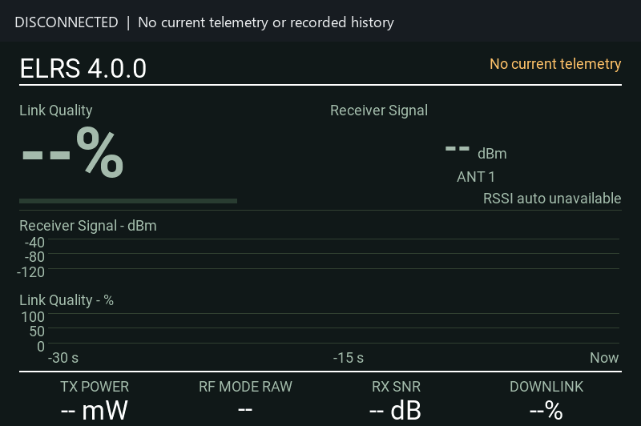
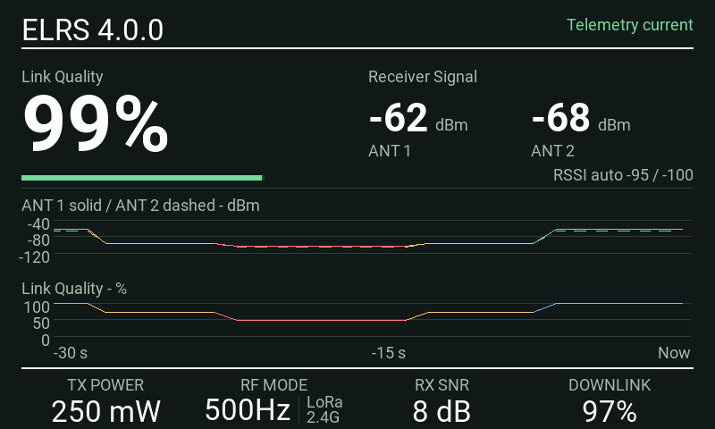
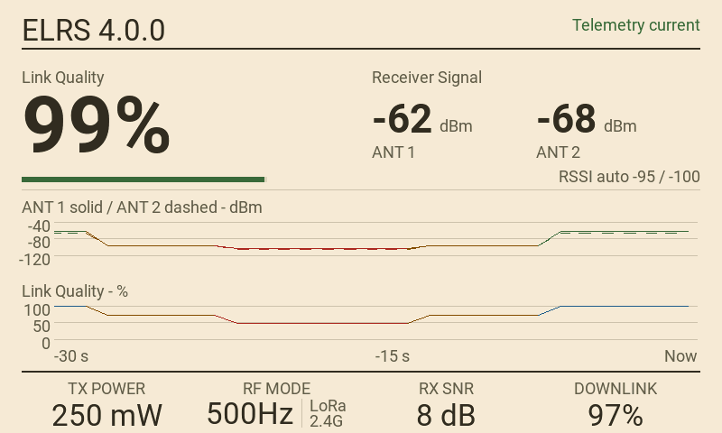
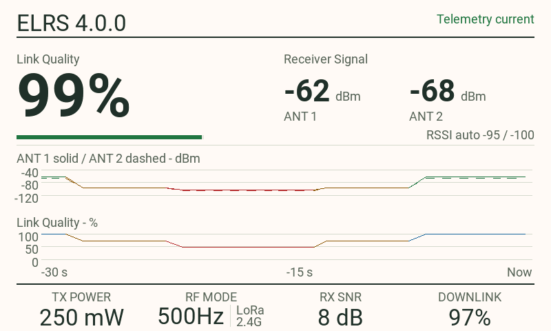
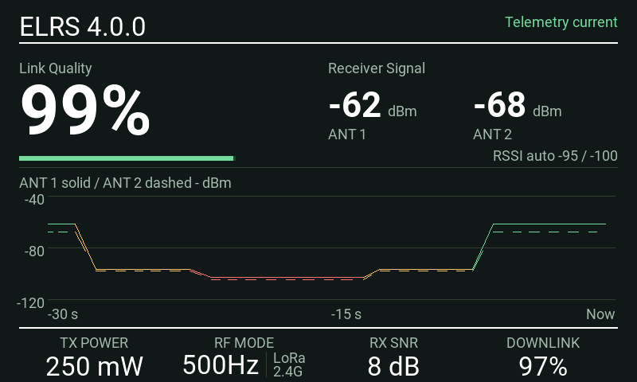
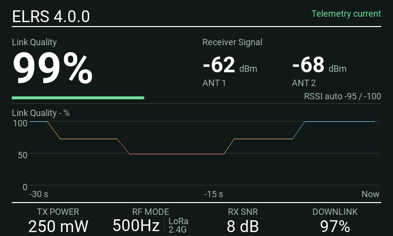
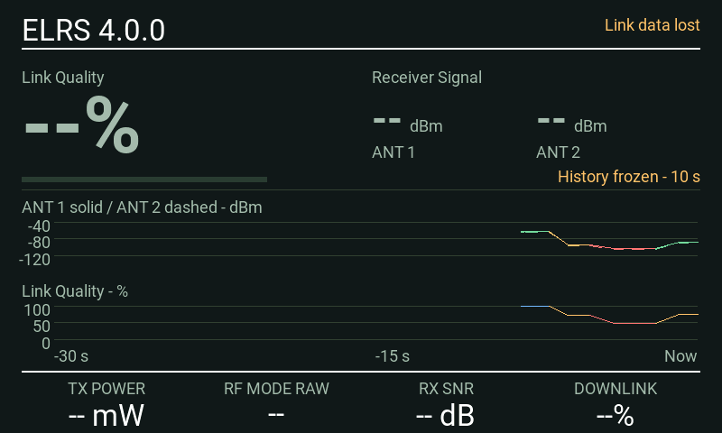

# ELRS SignalView

SignalView shows ExpressLRS receiver signal and Link Quality on your EdgeTX color radio. During a flight, you can watch both graphs and see when either reading starts to drop. After landing, you can scroll back through the last 15 minutes without opening a log viewer.

**Version 0.5.0** · [Download the widget](https://github.com/Pencilvestr/elrs-signalview/releases/download/v0.5.0/elrs-signalview-0.5.0.zip) · [Release notes](https://github.com/Pencilvestr/elrs-signalview/releases/tag/v0.5.0)

*EdgeTX 2.12.5 simulator with simulated ELRS telemetry.*

## Install

1. Download the widget ZIP above and back up your model settings and SD card.
2. Copy the `SignalView` folder from the ZIP into `WIDGETS` on your radio’s SD card. The file should be at `/WIDGETS/SignalView/main.lua`.
3. Restart the radio. Add **SignalView** to a single-widget screen with the EdgeTX top bar off.
4. Power on your receiver. If the readings stay blank, check that EdgeTX has discovered the receiver’s telemetry sensors.

The live dashboard works in full screen or in a large single-widget area. Open it **full screen** to review a flight. Small widget areas stay blank.

**Updating from 0.4.0?** Replace `main.lua` and restart the radio. Your widget settings carry over.

**Updating from 0.3.0?** Write down your settings and remove the old widget instance first. After replacing `main.lua` and restarting, add SignalView again and restore your settings. EdgeTX saves widget options by position, and Theme moved to the top of the menu in 0.4.0. [Installation and rollback guide](docs/INSTALLATION.md)

## Review a flight

Open SignalView full screen. **Hold either graph for one second and release**, or hold **Enter**. Turn the wheel or drag the graph to scroll through the flight. Use **Earlier** and **Later** to step one second at a time. Tap **Live** or briefly press **Exit** to return to the dashboard.

*TX16S MK3 simulator. The flight portion plays at 4× speed.*

Each screen shows 30 seconds of history. The numbers above the graphs show the **lowest reading for each signal during the selected second**. If Link Quality and RSSI both dipped in that second, their lowest points may have occurred at different moments.

SignalView keeps recording while you scroll. Once it has 15 minutes of history, each new second replaces the oldest one. The time shown is radio uptime. Restarting the radio or recreating the widget clears the history.

## Reading the dashboard

**Link Quality and receiver signal.** The Link Quality bar is green when the link is healthy. On the graphs, receiver signal normally appears green and Link Quality blue. Readings and traces turn amber or red when they cross your warning thresholds. These colors help you spot a change in the link. They can’t tell you how much range you have left.

**Antennas.** Auto starts with one reading. If the receiver reports valid RSSI on both antenna paths for one second, SignalView shows both, with a solid trace for one and a dashed trace for the other. A brief dropout on one path keeps the two-antenna layout. If you lose telemetry completely and reconnect with only one valid path, Auto returns to a single reading after five seconds. This follows the telemetry the receiver reports. You can also choose **Single** or **Dual** yourself.

**Telemetry loss.** If Link Quality and both antenna readings disappear, the current values change to `--`. The graphs freeze and a timer shows how long telemetry has been lost. You can still review the lead-up to the loss. When telemetry returns, a gap marks the outage.

**Footer.** The four readings default to TX power, RF mode, receiver SNR and downlink quality. You can change them with the EdgeTX source picker. SignalView shows a readable name for known ELRS 3.x and 4.x RF modes. Larger screens also show modulation and band when known. The header shows the transmitter module’s firmware version when the module reports it.

## Settings

Open **Widget Settings** on the radio. EdgeTX saves these choices for each widget instance in the model.

| Setting | Default | What it changes |
| --- | --- | --- |
| Theme | Dark | Choose Dark, Rich Ivory or White. |
| LQ amber | 80% | Link Quality turns amber below this value. |
| LQ red | 60% | Link Quality turns red below this value. |
| RSSI mode | Auto | Use RF-mode thresholds, set them manually, or turn RSSI warnings off. |
| RX amber | −98 dBm | Amber threshold in Manual mode. |
| RX red | −103 dBm | Red threshold in Manual mode. |
| Recover s | 1 | How long an improved reading must hold before its color returns to normal or drops from red to amber. |
| Footer 1–4 | TPWR / RFMD / RSNR / TQly | Choose which supported ELRS readings appear along the bottom. |
| Antennas | Auto | Choose Auto, Single or Dual. |
| History | Both | Show both graphs, receiver signal only, or Link Quality only. SignalView keeps recording both. |

**Choosing an RSSI mode.** On ELRS 4.x, Auto uses the sensitivity limit for the current RF mode. Amber is 10 dB above that limit and red is 5 dB above it. For example, a mode with a −105 dBm limit gives you thresholds of −95 and −100 dBm. On ELRS 3.x, choose Manual or Off. In 0.5.0, if the header hasn’t identified the module version, use Auto only if you’ve confirmed the transmitter runs ELRS 4.x. [Settings guide](docs/SETTINGS.md) · [RF-mode reference](docs/RF-MODES.md)

## Screenshots

| Dark | Rich Ivory | White |
| --- | --- | --- |
|  |  |  |

| Receiver signal only | Link Quality only | Telemetry loss |
| --- | --- | --- |
|  |  |  |

The [screenshot gallery](docs/SCREENSHOTS.md) also shows the smaller landscape screens and the NV14 portrait layout.

## Known working hardware

| Radio | Transmitter ELRS | EdgeTX | Test report |
| --- | --- | --- | --- |
| RadioMaster TX16S MK3 | Internal module, 4.0.0 | 2.12.5 | I ran three separate 10-minute bench tests with the 0.5.0 history-review build. I saw no issues. |
| PA01 | 4.1.0 | Unknown | A PA01 user reported that SignalView 0.3.0 worked on their radio. |

If you’ve tested SignalView on another setup, I’d like to add it here. Please include the widget version, radio, EdgeTX version, ELRS version and receiver model. Let me know whether you tested on the bench or in flight. [Submit a hardware report](https://github.com/Pencilvestr/elrs-signalview/issues/new/choose)

## Known Issues

## Support

If SignalView has been useful on your radio, you can [buy me a coffee on Ko-fi](https://ko-fi.com/pencilvestr).

## Help and feedback

If something looks wrong, tell me what the radio showed, what you expected, and how to reproduce it. For a Lua error, the full message or a photo of the screen helps. Leave binding phrases and personal SD-card backups out of public reports. [Report a bug or request a feature](https://github.com/Pencilvestr/elrs-signalview/issues/new/choose)

[Troubleshooting](docs/TROUBLESHOOTING.md) · [Telemetry reference](docs/TELEMETRY.md) · [Development guide](docs/DEVELOPMENT.md) · [Contributing](CONTRIBUTING.md) · [Changelog](CHANGELOG.md)

## License and attribution

SignalView is an independent community project released under the [MIT License](LICENSE). Project references and credits are in [NOTICE](NOTICE.md).
