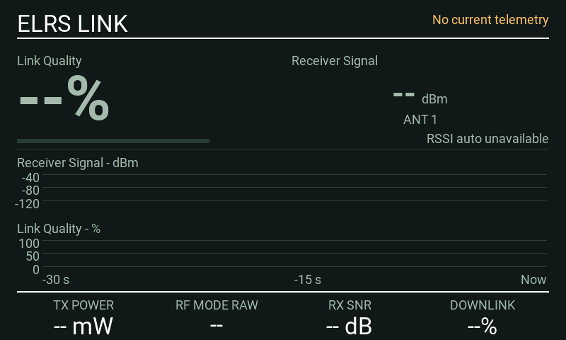
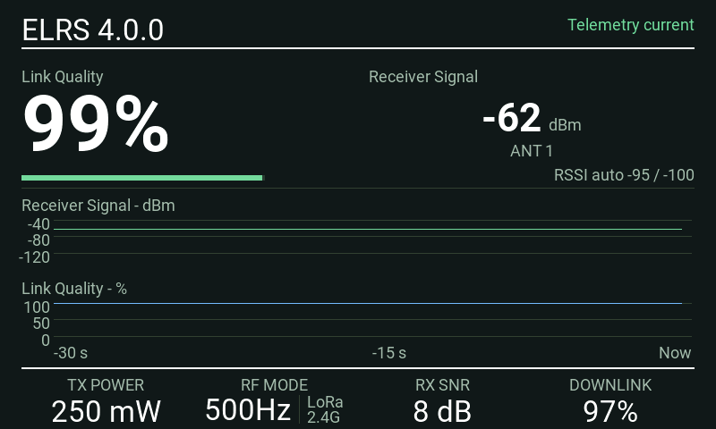
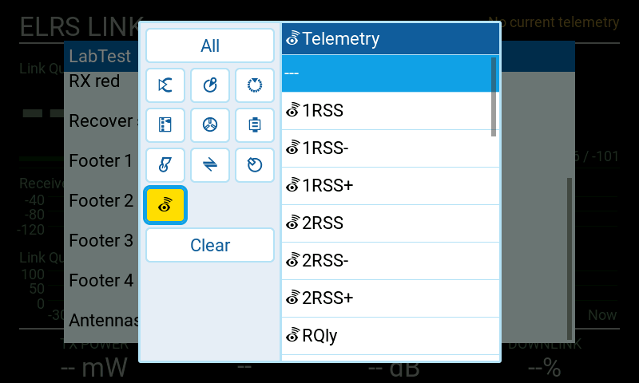

# Screenshot gallery

[Back to README](../README.md)

All dashboard images below are actual native EdgeTX 2.12.5 simulator captures. Telemetry and the reported module version are injected test data, not live RF measurements. They illustrate layout and state handling, not real-world signal limits. No physical-radio photographs were supplied for this documentation.

## Animated dashboard

A continuous 40-second native MK3 simulator capture at four frames per second. It begins with no current telemetry and empty history, then connects, qualifies both antenna paths, and shows synthetic receiver signal and Link Quality falling into amber and red before recovering. Transmit power, readable RF mode, receiver SNR and downlink quality also change. RF-mode changes are scripted demonstration steps, not automatic module behavior. The history uses normal widget sampling and drawing. The loop visibly returns to its disconnected starting state; no zero-valued signal readings are fabricated.

Reproduce with the native worker's `--demo` option, then run `python tools/build_demo.py`. The GIF uses a shared palette derived from the captured frames; no readings or graph lines are drawn separately.

## MK3: normal, warning and degraded

## MK3: stale data and full history

## Smaller landscape screens

TX16S, 480 × 272:

TX15, 480 × 320:

PA01, 320 × 240:

## Portrait screen

NV14, 320 × 480:

## Settings

The settings editor image is from the test observer and shows its temporary `LabTest` title, non-default thresholds and a two-second recovery setting. The production picker name is SignalView; the defaults are documented in [Settings](SETTINGS.md). The Footer 1 field uses the native source picker.

## Footer source picker

The picker lists radio sources and discovered telemetry. Choose a supported ELRS sensor without a minimum/maximum suffix. The temporary LabTest title belongs to the test observer.

## Updating screenshots

Use fresh native results whenever the layout or display behavior changes. Preserve their native dimensions. Record firmware, target, source hash and whether telemetry was synthetic in `images/manifest.json`. Do not label an HTML concept mockup as a radio or firmware screenshot.
