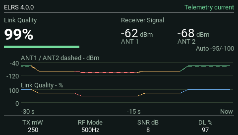
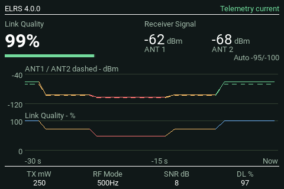
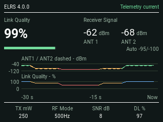
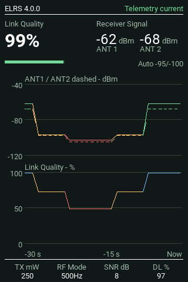

# Screenshot gallery

[Back to README](../README.md)

These images show the **0.4.0** interface, captured from its development candidate in the native EdgeTX **2.12.5** simulator. Telemetry and module-version responses are synthetic. They illustrate the UI, not measured RF performance. Exact capture versions and source hashes are recorded in the image manifest.

## Animated dashboard

The 40-second loop starts with no current telemetry and empty history. It connects, qualifies both antenna paths, and shows signal degradation and recovery. Footer readings also change. Scripted RF-mode changes demonstrate the labels; they are not automatic module behavior.

## Themes

Dark, the default:

Rich Ivory:

White, with a neutral off-white background:

## History selection

Both graphs are shown in the theme images above. The single-graph choices retain the main readings and footer, enlarge the selected graph and include midpoint scale labels.

Receiver Signal:

Link Quality:

## Connection and warning states

No current telemetry:

Amber warning:

Red degraded readings:

Complete graph-data loss:

The frozen graph remains available after the live readings become unavailable. It resumes with a break when telemetry returns. The right-edge label remains `Now`.

## Smaller landscape screens

TX16S, 480 × 272, with the approved separation between history graphs:

TX15, 480 × 320, with the same added separation:

PA01, 320 × 240, retaining its compact two-graph layout:

## Portrait screen

NV14, 320 × 480, with added graph separation and midpoint scale labels:

## Settings

This capture uses non-default persistence-test settings and the test observer's temporary `LabTest` title. The production widget is named **SignalView**. Theme appears first; History follows Antennas at the bottom. RSSI mode, Theme, Antennas and History use native dropdowns. Footer 1–4 use EdgeTX's source picker. See [Settings](SETTINGS.md) for defaults and upgrade notes.

## Capture provenance

Images retain their native dimensions. The [image manifest](images/manifest.json) records source hashes, image hashes, simulator version and capture provenance; it also retains entries for older reference assets not displayed here.

The GIF uses a shared palette derived from native captures. No readings or graph traces are drawn onto the images afterward. Reproduce the animation with the native worker's `--demo` option and `python tools/build_demo.py`. See [Testing](TESTING.md) for the simulator workflow.
