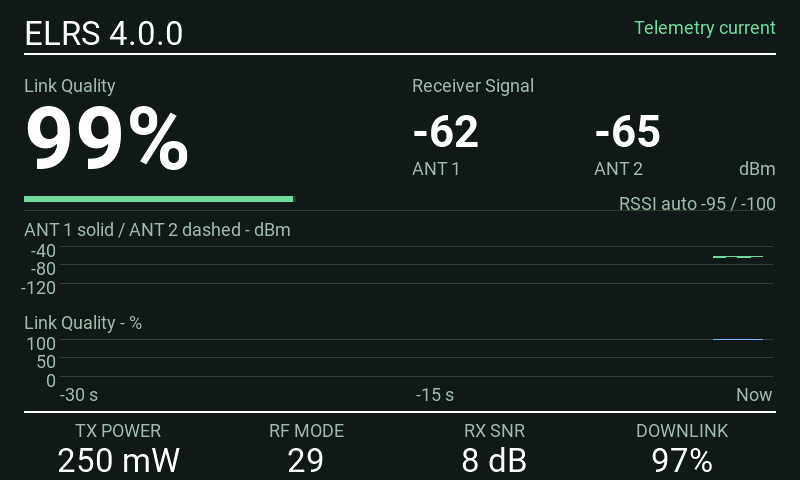
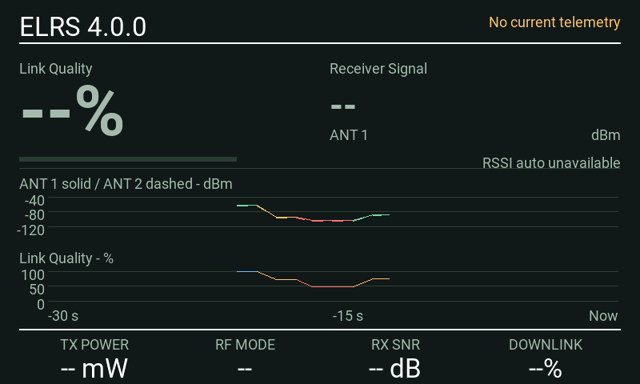
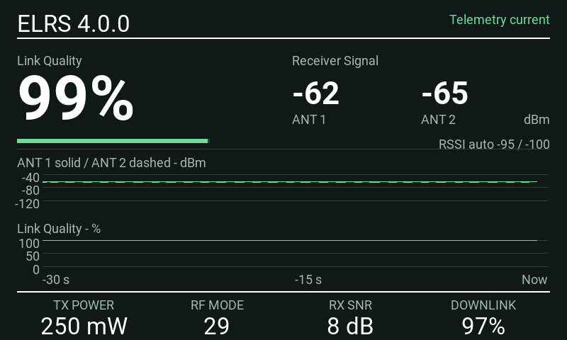
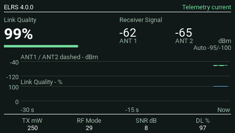
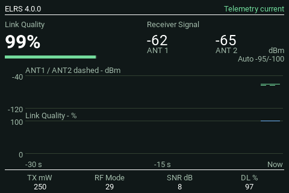
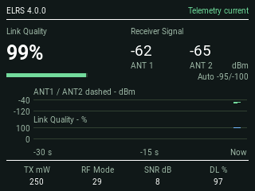
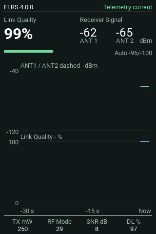
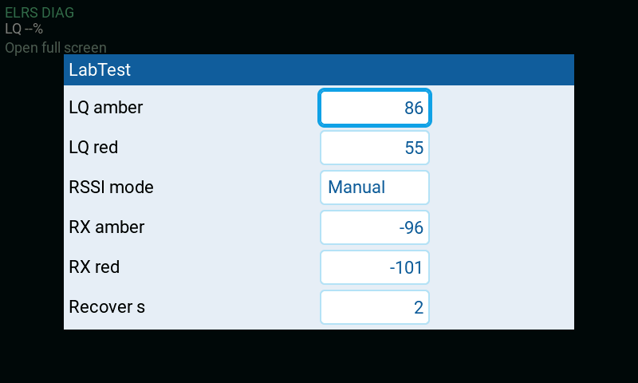

# Screenshot gallery

[Back to README](../README.md)

All dashboard images below are actual native EdgeTX 2.12.5 simulator captures. Telemetry and the reported module version are injected test data, not live RF measurements. They illustrate layout and state handling, not real-world signal limits. No physical-radio photographs were supplied for this documentation.

## Animated dashboard

A continuous 24-second native MK3 simulator capture at four frames per second, following a history warm-up. Synthetic receiver signal and Link Quality fall into amber and red, then recover. Transmit power, RF-mode index, receiver SNR and downlink quality also change. RF-mode changes are scripted demonstration steps, not a claim that the module automatically changes modes. The history uses the widget's normal sampling and drawing. The recording loops with a visible restart; it is not a live RF measurement.

Reproduce with the native worker's `--demo` option, then run `python tools/build_demo.py`. The GIF uses a shared palette derived from the captured frames; no readings or graph lines are drawn separately.

## MK3: normal, warning and degraded

## MK3: stale data and full history

## Smaller landscape screens

TX16S, 480 × 272:

TX15, 480 × 320:

PA01, 320 × 240:

## Portrait screen

NV14, 320 × 480:

## Settings

The settings editor image is from the test observer and shows its temporary `LabTest` title, non-default thresholds and a two-second recovery setting. The production picker name is SignalView; the defaults are documented in [Settings](SETTINGS.md). This is an earlier settings-persistence capture, not the current normal dashboard.

## Updating screenshots

Use fresh native results whenever the layout or display behavior changes. Preserve their native dimensions. Record firmware, target, source hash and whether telemetry was synthetic in `images/manifest.json`. Do not label an HTML concept mockup as a radio or firmware screenshot.
